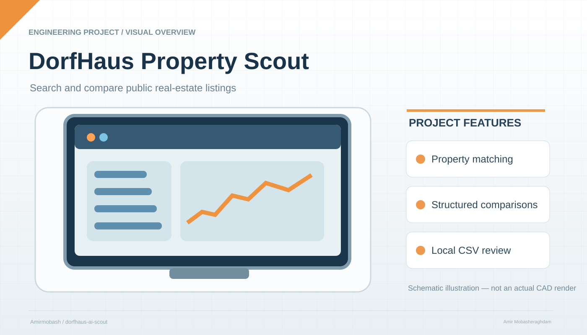

# DorfHaus & Wohnungs-Scout 🏡


<p align="center"></p>

<sub>Illustrative project schematic; not an actual CAD export, hardware photograph, or independently tested result.</sub>


**Häuser und Eigentumswohnungen zwischen Köln und Düsseldorf strukturiert finden und bewerten.**

Kostenloses, quelloffenes, lokal ausführbares Werkzeug für die Prüfung öffentlich indexierter Immobilienangebote und eigener CSV-Dateien.

**Projekt von Amirmobash.** Keine privaten Kontakt-, Arbeitgeber-, Hochschul- oder Kontodaten im Repository.

## Funktionen

- **Haus / Wohnung / Beides** wählen; separate Suchbegriffe für Häuser und Eigentumswohnungen.
- Kaufpreisobergrenze standardmäßig **120.000 €** (frei änderbar).
- Suchprofil mit Ramrath, Frixheim, Anstel, Nettesheim, Butzheim, Oekoven, Deelen, Evinghoven und weiteren Orten im Korridor Köln–Düsseldorf.
- Optional nur Suchtreffer mit expliziter Ortsnennung zeigen; Fachwerk- und deutliche Sanierungshinweise ausfiltern.
- Öffentlich zugängliche Bing-RSS-Suchergebnisse für **Sparkassen-Immobilien**, **VON POLL**, ImmobilienScout24, immowelt, Kleinanzeigen, meinestadt.de und VR-Immobilien abfragen. Original-Links öffnen.
- Ergebnisse nach Suchlauf weiter anzeigen, als CSV exportieren oder lokal in SQLite merken.
- Eigene CSV-Angebote als Haus oder Wohnung importieren, Wohnfläche/Preis filtern und Kaufnebenkosten bzw. monatliche Kreditrate modellhaft berechnen.
- Bei Wohnungen Hinweise auf **Hausgeld, Sonderumlage, Instandhaltungsrücklage, Vermietung und Erbpacht** markieren; optional Hausgeld im CSV erfassen.
- Datenbank bestehender Nutzer wird beim ersten Speichern automatisch um die Wohnungsfelder erweitert.

## Wichtige Grenzen

**Keine garantierte Live- oder Vollsuche:** Die Software fragt nur den öffentlich verfügbaren Suchindex per Bing-RSS ab. Sie greift nicht direkt auf Immobilienportal-Webseiten zu, umgeht keine Zugangssperren und verwendet keinen kostenpflichtigen API-Schlüssel. RSS-Ergebnisse können veraltet, unvollständig oder leer sein. Die Anbieter können ihre Suchindex-Ausgabe jederzeit ändern.

**Ein Inserat ist keine Bauprüfung.** Preisangaben stammen nur aus Überschriften oder Suchtext. Fehlt eine Preisangabe, wird sie ausdrücklich als **unbekannt** markiert und nicht als bestätigter Budgettreffer gezählt. Fehlende Fachwerk- oder Sanierungsbegriffe beweisen weder Massivbau noch Bezugsfertigkeit. Orte werden nur aus dem Indextext erkannt; die tatsächliche ländliche Lage und **Autofahrtzeiten von maximal 40 Minuten** werden nicht automatisch überprüft. Bei Wohnungen sollten Teilungserklärung, Hausgeld, WEG-Protokolle, Rücklagen und mögliche Sonderumlagen vor dem Kauf geprüft werden.

## Start unter Windows

1. Das Repository über **Code → Download ZIP** herunterladen und entpacken.
2. `start.bat` doppelklicken.
3. Der Starter erstellt lokal eine Python-Umgebung und installiert die in `requirements.txt` genannten freien Pakete. Wenn Python fehlt, wird eine Installation über `winget` **nur nach Bestätigung** angeboten. Danach den Starter erneut ausführen.
4. In der Weboberfläche **Immobilienart**, **Kaufpreis**, **Dörfer** und **Ausschlussfilter** auswählen und **„Immobilien jetzt suchen“** anklicken.
5. Die Treffer mit dem Originalinserat abgleichen; alternativ eigene CSV importieren.

Falls Windows die Installation blockiert: Python 3.11+ von python.org installieren und `start.bat` erneut ausführen. Keine GitHub-Actions-Läufe oder GitHub-Bezahldienste erforderlich. Die Installation benötigt Internetzugang, verursacht aber keine beabsichtigten Lizenz- oder GitHub-Servicegebühren.

## Alternativer Start

```bash
python -m venv .venv
# Windows: .venv\Scripts\activate
# Linux/macOS: source .venv/bin/activate
pip install -r requirements.txt
python -m streamlit run app.py
```

## CSV-Import

Pflichtspalten: `titel,preis,wohnflaeche,ort,url,beschreibung,quelle`.

Optionale Spalten: `immobilienart` (`Haus` oder `Wohnung`), `hausgeld` (monatlich in Euro). Ohne `immobilienart` erfolgt eine vorsichtige Texterkennung aus dem Titel/der Beschreibung. Die Datei `beispiele/angebote.csv` enthält **ausschließlich fiktive Testobjekte**, keine echten Kaufangebote.

## Lokale Tests (ohne GitHub Actions)

```bash
python -m pip install -r requirements.txt
python -m pytest -q
```

Steuern und Zinsen sind änderbare Modellannahmen, keine Angebote. Die Grunderwerbsteuer in NRW wird als 6,5 % angesetzt. Laufendes Hausgeld ist **nicht** in der Darlehensrate enthalten.

## Datenschutz & Kosten

Die Weboberfläche wird lokal gestartet, die Datenbank lokal gespeichert. Nur die Suchanfragen gehen an den öffentlichen Suchindex, sobald der Nutzer die Suche startet. Keine persönlichen Daten in den öffentlichen Quellcode oder Beispieldateien schreiben. Kein automatischer GitHub-Workflow und kein kostenpflichtiger Suchanbieter erforderlich.

## Roadmap

1. Erlaubte, dokumentierte Portalschnittstellen prüfen und ergänzen.
2. Standort- und Fahrzeiten mit einer geeigneten freiwilligen Routinganbindung verifizieren.
3. Historie, Dubletten und auf Wunsch lokale Benachrichtigungen ergänzen.

## Inspiration

- [Fredy](https://github.com/orangecoding/fredy) – Quellenadapter und Benachrichtigungen
- [wohnung-notifier-bot](https://github.com/alice17/wohnung-notifier-bot) – Mehrquellensuche

Keine Fremdquelltexte übernommen.

Lizenz: MIT. Copyright (c) 2026 Amirmobash.
